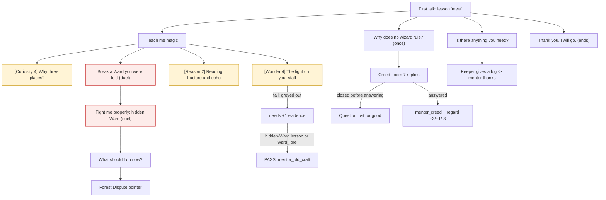

# The Mentor: introduction, lessons and the creed question

Collection CV-MENTOR · workbook rows B_Dialogue (MENTOR.*) and C_Choices. The mentor is the only dedicated teacher. There is no failing state; the lessons end when done, after a wizard duel or death, or after 5 minutes.

## The story at a glance

```text
First talk (lesson ‘meet’)
│
├── Teach me magic ................................. lesson ‘colours’ (the three colours are already known)
│   ├── [Curiosity, demanding 4] Why three places? .. PASS for a fresh apprentice (3 +0 evidence +1 regard = 4): learns ‘ward_lore’
│   │                                                 FAIL line exists but cannot be reached in normal play
│   ├── [Wonder, demanding 4] The light on your staff  first try FAILS (2 +0 +1 = 3): button greys out
│   │                                                 PASS after +1 evidence (hidden-Ward lesson or ward_lore): learns ‘mentor_old_craft’
│   ├── [Reason, easy 2] Reading fracture and echo ..  PASS always (2 +0 +1 = 3): learns ‘ward_method’ (nothing reads it)
│   ├── Break a Ward you were told (Frost, Vine, Frost)  → practice duel → mentor comments: quick win / win / lost
│   │   └── Fight me properly (hidden Wards) ......... → practice duel → comments → lesson ‘hidden Ward’
│   │       └── What should I do now? ................ village pointer; names the Forest Dispute people if it is cast
│   │                                                  (shown twice while the quest is offered: DEF-02)
├── I know the colours. Test me. ................... shortcut, only after one earlier wizard duel
├── Why does no wizard simply rule? (single use) ... creed node: six belief replies + ‘I will think about it’
│                                                      (close the conversation here and the answers are lost: DEF-01)
├── Is there anything you need? .................... the log errand (keeper → mentor thanks, regard +5)
└── Thank you. I will go. .......................... ends
```




**What each person says on entry, in order (the first entry whose conditions hold is spoken; the rest are ignored)**

*Mentor*

| # | Entry | Speaks when | First line |
|---|-------|-------------|------------|
| 1 | `v-first` | “you have had your first conversation with the mentor” has NOT happened | There you are. Late again, but I will forgive it. I was late to my own first lesson, and… |
| 2 | `v-mira_near` | “you have had your first conversation with the mentor” has happened; “the mentor remarked on Mira” has NOT happened; mira_near (1 if Mira is within f… | And Mira, trailing you like a second shadow. Good. She learned the stance in a week; watc… |
| 3 | `v-log_thanks` | you have learned: you brought the mentor a log (set by the keeper); you have NOT learned: the mentor thanked you for the log | You brought the log. Dry, from the good stack; the keeper likes you, then, which is rarer… |
| 4 | `v-steered` | “you have had your first conversation with the mentor” has happened; “the mentor remarked on your two deaths” has NOT happened; my_deaths (times this… | Twice dead before noon. Some mornings I wonder whether the pair of you are steering, or b… |
| 5 | `v-killer` | “you have had your first conversation with the mentor” has happened; “the mentor gave his speech about killing a friend” has NOT happened; my_kills (… | You killed your friend in the road and brought them back before supper. I had a speech pr… |
| 6 | `v-died` | “you have had your first conversation with the mentor” has happened; “the mentor remarked that you died and were brought back” has NOT happened; my_d… | You died. I felt it in my teeth, the way one does. And then somebody fetched you back, wh… |
| 7 | `v-brawler` | “you have had your first conversation with the mentor” has happened; “the mentor remarked on your early duels” has NOT happened; lesson NOT yet done:… | Three duels before your first lesson. I have taught stubborn pupils and lazy ones; you ar… |
| 8 | `v-told_won_quick` | “you just finished the ‘told Ward’ duel (the mentor comments once)” has happened; “you won the ‘told Ward’ duel” has happened; “you won in three cast… | Three casts, and a clean break. I told you what it was, and you listened to the feedback… |
| 9 | `v-told_won` | “you just finished the ‘told Ward’ duel (the mentor comments once)” has happened; “you won the ‘told Ward’ duel” has happened | Broken. That is what a fracture is: the right colour in the right place, until every plac… |
| 10 | `v-told_lost` | “you just finished the ‘told Ward’ duel (the mentor comments once)” has happened; “you won the ‘told Ward’ duel” has NOT happened | It held, though I told you what it was. Do not be ashamed; this is what practice is for,… |
| 11 | `v-hidden_won_quick` | “you just finished the hidden-Ward duel (the mentor comments once)” has happened; “you won the hidden-Ward duel” has happened; “you won in three cast… | Quickly, and fairly. You read the echoes better than I did at your age, and I will deny s… |
| 12 | `v-hidden_won` | “you just finished the hidden-Ward duel (the mentor comments once)” has happened; “you won the hidden-Ward duel” has happened | Broken, and fairly. You read the echoes well. That is the whole craft: guess, listen, and… |
| 13 | `v-hidden_lost` | “you just finished the hidden-Ward duel (the mentor comments once)” has happened; “you won the hidden-Ward duel” has NOT happened | My Ward held, or yours fell first. Either way you have fought a hidden Ward, and that is… |
| 14 | `v-flame_praise` | “the mentor praised your use of Flame” has NOT happened; lesson done: Use Flame in the world (optional) | I smelled smoke from the square. So you have tried Flame on something that was not a cand… |
| 15 | `v-v15` | lesson done: Duel a hidden Ward; campaign stage is explore (free exploration before the stranger) or arrival (the stranger is walking in) | You have the basics, and that is all they are. Magic is not for duels. Walk the village a… |
| 16 | `v-v16` | lesson done: Duel a hidden Ward | I have taught you what I can for now. |
| 17 | `v-v17` | lesson done: Break a Ward you were told | You have broken a Ward I named aloud. Now try one you cannot see. |
| 18 | `v-v18` | lesson done: Learn the three colours | You know your three colours. Try your hand against my Ward when you are ready. |
| 19 | `v-v19` | otherwise (entry 19 of 19; the first one whose conditions hold is spoken) | What would you like to learn? |


## Detailed choice tree (generated from the game's data)

Read each line as: **[Aspect, difficulty number]** is a skill check; `needs`/`after`/`not if` are the conditions that decide whether the choice is offered; `says` is the first line of the response; `effects` are the lasting consequences. A child is shown under the choice that makes it available.

```text
■ The Mentor (teacher)
├── “Teach me magic.”
│   │   · needs: lesson NOT yet done: Learn the three colours
│   │   · after: you have had your first conversation with the mentor
│   │   · says: “Three colours to begin: Flame, which burns; Frost, which stills; Vine, which binds. Hold each one i…”
│   │   · effects: Set “the mentor has taught (or acknowledged) the three colours”; Learn Flame, Frost, Vine; weave size 3 [once]; Lesson done: Learn the three colours [once]
│   ├── [Curiosity, demanding 4] “Why does a Ward have three places? Who decided that?”
│   │       · needs: lesson done: Learn the three colours
│   │       · says: “{name} leans on the staff and considers you for a moment.”
│   │       · check: Curiosity demanding (4); evidence: +1 lesson done: Break a Ward you were told
│   │       · PASS → “Nobody asks that. Good. Three is the smallest number that can hide a pattern and still be…” · You learn: the mentor told you why a Ward has three places…
│   │       · FAIL → “Because it is. That is how it was taught to me, and I never thought to ask. Perhaps you w…” · stays in the conversation; button greyed until the score, evidence or regard changes
│   ├── [Wonder, demanding 4] “There is a light around your staff when you cast. That is not Flame, is it?”
│   │       · needs: lesson done: Learn the three colours
│   │       · check: Wonder demanding (4); evidence: +1 you have learned: the mentor told you why a Ward has three…; +1 lesson done: Duel a hidden Ward
│   │       · PASS → “...No. It is not Flame. It is something older than the schools, and the schools stopped t…” · You learn: the mentor admitted the light around his staff i…
│   │       · FAIL → “A trick of the evening light. Come, you are staring.” · stays in the conversation; button greyed until the score, evidence or regard changes
│   ├── [Reason, easy 2] “Explain how to read fracture and echo properly, as a method.”
│   │       · needs: lesson done: Learn the three colours
│   │       · check: Reason easy (2); evidence: none
│   │       · PASS → “Every Fade is information: if a colour fades everywhere, it is not in the Ward at all, an…” · You learn: the mentor explained how to read fracture and ec…
│   │       · FAIL → “Pay attention to what the Ward tells you, and do not guess the same thing twice. The rest…” · stays in the conversation; button greyed until the score, evidence or regard changes
│   └── “Let me try to break your Ward. You tell me what it is.”
│       │   · needs: lesson done: Learn the three colours
│       │   · says: “My Ward is Frost, Vine, Frost. I will not change it. Break it in as few casts as you can.”
│       │   · effects: Start a Ward duel against opponent.teacher_told (purpose: told_ward); the oppon…
│       │   · → starts a Ward duel; the conversation ends and the mentor comments afterwards
│       └── “Fight me properly, with hidden Wards.”
│           │   · needs: lesson done: Break a Ward you were told
│           │   · says: “Mine is hidden now, and so is yours. We cast until one Ward breaks. Do not pull your casts; I will…”
│           │   · effects: Start a Ward duel against opponent.teacher_hidden (purpose: hidden_ward)
│           │   · → starts a Ward duel; the conversation ends and the mentor comments afterwards
│           ├── “What should I do now?”
│           │       · needs: lesson done: Duel a hidden Ward; the village stories are unlocked; quest ‘forest_dispute’ is offered / active / done
│           │       · says: “Not a spell. Listen. Walk through the village, speak to the carriers, the foresters, the guards. A…”
│           │       · effects: Set “the mentor told you about the quarrel in the forest”; Lesson done: Hear what the village needs (optional) [once]
│           └── “What should I do now?”
│                   · needs: lesson done: Duel a hidden Ward
│                   · says: “Not a spell. Listen. Walk through the village, speak to the carriers, the foresters, the guards. A…”
│                   · effects: Lesson done: Hear what the village needs (optional) [once]
├── “I know the colours. Test me.”
│       · needs: lesson NOT yet done: Learn the three colours; my_pvp_duels (this wizard's own wizard-versus-wizard duels) is at least 1
│       · after: you have had your first conversation with the mentor
│       · says: “So I gather. Then we skip the pages and go to the part that matters: reading what a Ward tells you.…”
│       · effects: Set “the mentor has taught (or acknowledged) the three colours”; Lesson done: Learn the three colours [once]
├── “You could do anything you liked. Why does no wizard simply rule?”
│   │   · after: you have had your first conversation with the mentor
│   │   · single use
│   │   · says: “{name} is quiet for a while.”
│   │   · → moves to node ‘creed’
│   ├── “Then what we can do belongs to the land, not to us.”
│   │       · says: “"Yes," {name} says, and the old face softens. "Balance. We borrow from the world. You listen better…”
│   │       · effects: Set “you answered the mentor's question about why wizards do not rule”; Worldview shift towards Druidic (the table row for that view, once) [once]; Regard of the speaker for you +3 [once]; You learn: you answered the mentor's question about why wizards do not rule [on…
│   ├── “Then a wizard serves, the way a good steward serves.”
│   │       · says: “"Serves, and answers for it. Yes. Authority is a weight carried for others. You will do."”
│   │       · effects: Set “you answered the mentor's question about why wizards do not rule”; Worldview shift towards Monarchist (the table row for that view, once) [once]; Regard of the speaker for you +3 [once]; You learn: you answered the mentor's question about why wizards do not rule [on…
│   ├── “Or nobody should rule anybody, wizard or not.”
│   │       · says: “"Perhaps. I will not argue it. I would only add that the day nobody rules is the day everyone must…”
│   │       · effects: Set “you answered the mentor's question about why wizards do not rule”; Worldview shift towards Anarchist (the table row for that view, once) [once]; Regard of the speaker for you +1 [once]; You learn: you answered the mentor's question about why wizards do not rule [on…
│   ├── “Then pay it honestly: teach, trade, and keep fair books.”
│   │       · says: “"Fair books. I have not heard it put that way, but a debt that is written down is harder to forget.…”
│   │       · effects: Set “you answered the mentor's question about why wizards do not rule”; Worldview shift towards Guildist (the table row for that view, once) [once]; Regard of the speaker for you +1 [once]; You learn: you answered the mentor's question about why wizards do not rule [on…
│   ├── “And yet someone has to lead, and surely those who understand the Weave should.”
│   │       · says: “"Surely. It is what every tyrant thinks first, and the kindest ones think it longest." {name} does…”
│   │       · effects: Set “you answered the mentor's question about why wizards do not rule”; Worldview shift towards Arcane Supremacist (the table row for that view, once)…; Regard of the speaker for you -3 [once]; You learn: you answered the mentor's question about why wizards do not rule [on…
│   ├── “I think it is a vow, whether we say so or not.”
│   │       · says: “"A vow. Yes. That is the word I could not find. We do not choose the gift, but we choose what we pr…”
│   │       · effects: Set “you answered the mentor's question about why wizards do not rule”; Worldview shift towards Religious (the table row for that view, once) [once]; Regard of the speaker for you +3 [once]; You learn: you answered the mentor's question about why wizards do not rule [on…
│   └── “I will think about it.”
│           · says: “"Do."”
│           · effects: Set “you answered the mentor's question about why wizards do not rule”; You learn: you answered the mentor's question about why wizards do not rule [on…
├── “Is there anything you need?”
│       · needs: you have NOT learned: the mentor asked you for a log for his brazier
│       · after: you have had your first conversation with the mentor
│       · says: “Since you ask: a log for the brazier. The store has them; the keeper will give you one if you ask k…”
│       · effects: You learn: the mentor asked you for a log for his brazier [once]
└── “Thank you. I will go.”
        · says: “Walk well. Come back when you want another lesson.”
        · → conversation ends
```
