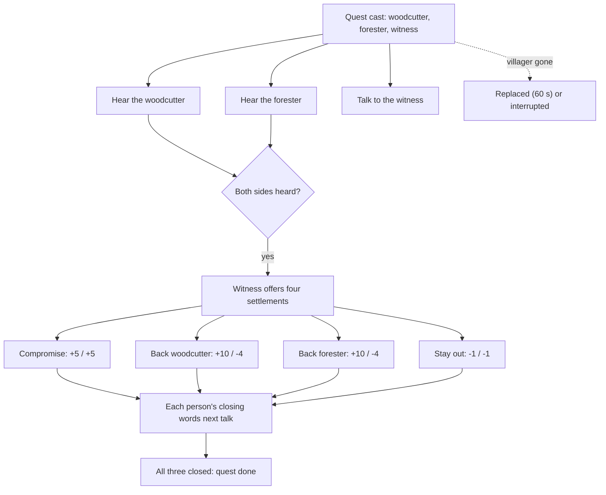

# The Forest Dispute (quest)

Collection CV-FOREST. A woodcutter and a forester (ordinary villagers cast from the simulation) quarrel over felling young trees; a witness saw part of it. Optional: nothing forces the player to hear it.

## The story at a glance

```text
Stories unlocked (four lessons, or 20 game-minutes) and villagers cast
│
├── Hear the woodcutter ... ‘What happened between you and <forester>?’ ........ flag: heard woodcutter
├── Hear the forester ..... ‘What happened between you and <woodcutter>?’ ...... flag: heard forester
└── The witness (soldier, else stonemason/hunter, else carrier)
    ├── ‘What did you see?’ / ‘What do people say?’ ............................ optional colour
    └── once BOTH sides are heard, choose one settlement:
        ├── Compromise:  woodcutter fells old trees, forester stakes young ones
        │                 regard woodcutter +5, forester +5 · journal note
        ├── Back the woodcutter: timber now ... woodcutter +10, forester −4 · journal note
        ├── Back the forester: let them grow ... forester +10, woodcutter −4 · journal note
        └── Stay out ................................ both −1 · journal note
              │
              └── each of the three says their own closing lines on the next talk;
                  after all three have, the quest is ‘done’ (journal objective clears)

Also: a villager dies/leaves → replaced within 60 game seconds, else ‘interrupted’ · too few villagers → never offered
```




**What each person says on entry, in order (the first entry whose conditions hold is spoken; the rest are ignored)**

*Woodcutter*

| # | Entry | Speaks when | First line |
|---|-------|-------------|------------|
| 1 | `v-c_closed_compromise` | “you settled the dispute with a compromise” has happened; “you have heard the woodcutter's side” has happened; “the woodcutter has spoken his closing… | Share the clearing. Well. I cut the old ones, {planter} marks the young ones with stakes,… |
| 2 | `v-c_closed_cutter` | “you backed the woodcutter” has happened; “you have heard the woodcutter's side” has happened; “the woodcutter has spoken his closing reaction” has N… | So the settlement's need counts for something after all. Good. I will still keep clear of… |
| 3 | `v-c_closed_planter` | “you backed the forester” has happened; “you have heard the woodcutter's side” has happened; “the woodcutter has spoken his closing reaction” has NOT… | You backed {planter}. Hm. Then the sawmill goes hungry for a season and I walk further fo… |
| 4 | `v-c_closed_none` | “you stayed out of the dispute” has happened; “you have heard the woodcutter's side” has happened; “the woodcutter has spoken his closing reaction” h… | You did nothing, then. That is also a choice, wizard. {planter} and I will go on not spea… |
| 5 | `v-c_after` | “the woodcutter has spoken his closing reaction” has happened | That is behind us now, or as far behind as these things go. Thank you for hearing me out. |
| 6 | `v-c_hub` | “you have heard the woodcutter's side” has happened | Back again? Everyone has an opinion on this. |
| 7 | `v-c_first` | otherwise (entry 7 of 7; the first one whose conditions hold is spoken) | I am cutting what I am meant to cut. The settlement needs timber, and the sawmill and the… |

*Forester*

| # | Entry | Speaks when | First line |
|---|-------|-------------|------------|
| 1 | `v-p_closed_compromise` | “you settled the dispute with a compromise” has happened; “you have heard the forester's side” has happened; “the forester has spoken her closing rea… | He agreed to the stakes? Then I will mark the young trees where he can see them, and he w… |
| 2 | `v-p_closed_cutter` | “you backed the woodcutter” has happened; “you have heard the forester's side” has happened; “the forester has spoken her closing reaction” has NOT h… | So timber comes first. I understand it; I plant for the settlement too. I will put the se… |
| 3 | `v-p_closed_planter` | “you backed the forester” has happened; “you have heard the forester's side” has happened; “the forester has spoken her closing reaction” has NOT hap… | Thank you. The seedlings thank you too, though they cannot say so. I will keep them stake… |
| 4 | `v-p_closed_none` | “you stayed out of the dispute” has happened; “you have heard the forester's side” has happened; “the forester has spoken her closing reaction” has N… | You stayed out of it. I hoped for more, but I will not blame you. I will keep planting an… |
| 5 | `v-p_after` | “the forester has spoken her closing reaction” has happened | It is settled as far as it will be. Thank you for listening, wizard. |
| 6 | `v-p_hub` | “you have heard the forester's side” has happened | Careful where you step. |
| 7 | `v-p_first` | otherwise (entry 7 of 7; the first one whose conditions hold is spoken) | Careful. There are seedlings under your boots. |

*Witness*

| # | Entry | Speaks when | First line |
|---|-------|-------------|------------|
| 1 | `v-w_done_compromise` | “the woodcutter has spoken his closing reaction” has happened; “the forester has spoken her closing reaction” has happened; “you settled the dispute… | A shared clearing, stakes and an axe. I never thought I would see those two agree on anyt… |
| 2 | `v-w_done_cutter` | “the woodcutter has spoken his closing reaction” has happened; “the forester has spoken her closing reaction” has happened; “you backed the woodcutte… | You backed the axe. The sawmill will be pleased, and {planter} will not, but the store wi… |
| 3 | `v-w_done_planter` | “the woodcutter has spoken his closing reaction” has happened; “the forester has spoken her closing reaction” has happened; “you backed the forester”… | You backed the saplings. Then it is a lean season for the sawmill, and {cutter} will not… |
| 4 | `v-w_done_none` | “the woodcutter has spoken his closing reaction” has happened; “the forester has spoken her closing reaction” has happened; “you stayed out of the di… | You stayed out of it. They are still not speaking, and everyone around them has noticed. |
| 5 | `v-w_after` | “the witness has spoken the closing reaction (the quest counts as done)” has happened | The forest is as it is. Thank you for your trouble, wizard. |
| 6 | `v-w_both` | “you have heard the woodcutter's side” has happened; “you have heard the forester's side” has happened; “you settled the dispute with a compromise” h… | You have heard them both. Well? Everyone wants to know what the wizard thinks. |
| 7 | `v-w_waiting` | “the witness told you what they actually saw” has happened; “you settled the dispute with a compromise” has NOT happened; “you backed the woodcutter”… | Have you spoken to them yet? I told them you might. |
| 8 | `v-w_first` | otherwise (entry 8 of 8; the first one whose conditions hold is spoken) | I was passing the clearing when I saw the two of them, so I know a little. Not much, but… |


## Detailed choice tree (generated from the game's data)

Read each line as: **[Aspect, difficulty number]** is a skill check; `needs`/`after`/`not if` are the conditions that decide whether the choice is offered; `says` is the first line of the response; `effects` are the lasting consequences. A child is shown under the choice that makes it available.

```text
■ The woodcutter (cutter)
├── “What happened between you and {planter}?”
│   │   · not if: you have heard the woodcutter's side
│   │   · says: “The old trees near my hut were ripe. {planter} has been planting new saplings in the same clearings…”
│   │   · effects: Set “you have heard the woodcutter's side”
│   └── “What would settle it for you?”
│           · after: you have heard the woodcutter's side
│           · not if: you asked the woodcutter what would settle it
│           · says: “A part of the forest I may cut without being shouted at. And a promise that nobody plants on top of…”
│           · effects: Set “you asked the woodcutter what would settle it”
└── “I will let you get on.”
        · says: “Mind the axe, then.”
        · → conversation ends

■ The forester (planter)
├── “What happened between you and {cutter}?”
│   │   · not if: you have heard the forester's side
│   │   · says: “I plant where the old ones were felled, so the forest comes back. There are {saplings} saplings and…”
│   │   · effects: Set “you have heard the forester's side”
│   └── “What would settle it for you?”
│           · after: you have heard the forester's side
│           · not if: you asked the forester what would settle it
│           · says: “Stakes around the young trees, and a word that he will leave them be. That is all. I do not need hi…”
│           · effects: Set “you asked the forester what would settle it”
└── “I will let you get on.”
        · says: “Mind the seedlings.”
        · → conversation ends

■ The witness (witness)
├── “What did you see?”
│       · not if: the witness told you what they actually saw
│       · says: “{cutter} with an axe on one shoulder, {planter} with a basket of saplings, and both of them red in…”
│       · effects: Set “the witness told you what they actually saw”
├── “What do people say?”
│       · not if: the witness told you only gossip
│       · says: “That {cutter} cuts without looking and {planter} plants without asking. That the sawmill is hungry…”
│       · effects: Set “the witness told you only gossip”
├── “Suggest they share the clearing: {cutter} cuts the old trees, {planter} stake…”
│       · after: you have heard the woodcutter's side; you have heard the forester's side
│       · not if: you settled the dispute with a compromise; you backed the woodcutter; you backed the forester; you stayed out of the dispute
│       · says: “I will pass that on. It might work, if neither of them has to lose face.”
│       · effects: Set “you settled the dispute with a compromise”; Regard of the woodcutter for you +5 [once]; Regard of the forester for you +5 [once]
├── “Back {cutter}: the settlement needs timber now.”
│       · after: you have heard the woodcutter's side; you have heard the forester's side
│       · not if: you settled the dispute with a compromise; you backed the woodcutter; you backed the forester; you stayed out of the dispute
│       · says: “Timber first. I will say so. {planter} will not like it.”
│       · effects: Set “you backed the woodcutter”; Regard of the woodcutter for you +10 [once]; Regard of the forester for you -4 [once]
├── “Back {planter}: let the young trees grow.”
│       · after: you have heard the woodcutter's side; you have heard the forester's side
│       · not if: you settled the dispute with a compromise; you backed the woodcutter; you backed the forester; you stayed out of the dispute
│       · says: “Saplings first. I will say so. {cutter} will not like it.”
│       · effects: Set “you backed the forester”; Regard of the forester for you +10 [once]; Regard of the woodcutter for you -4 [once]
├── “Stay out of it. It is theirs to settle.”
│       · after: you have heard the woodcutter's side; you have heard the forester's side
│       · not if: you settled the dispute with a compromise; you backed the woodcutter; you backed the forester; you stayed out of the dispute
│       · says: “As you like. I will not carry anything either.”
│       · effects: Set “you stayed out of the dispute”; Regard of the woodcutter for you -1 [once]; Regard of the forester for you -1 [once]
└── “I will let you get on.”
        · says: “Keep your eyes open, wizard.”
        · → conversation ends
```
