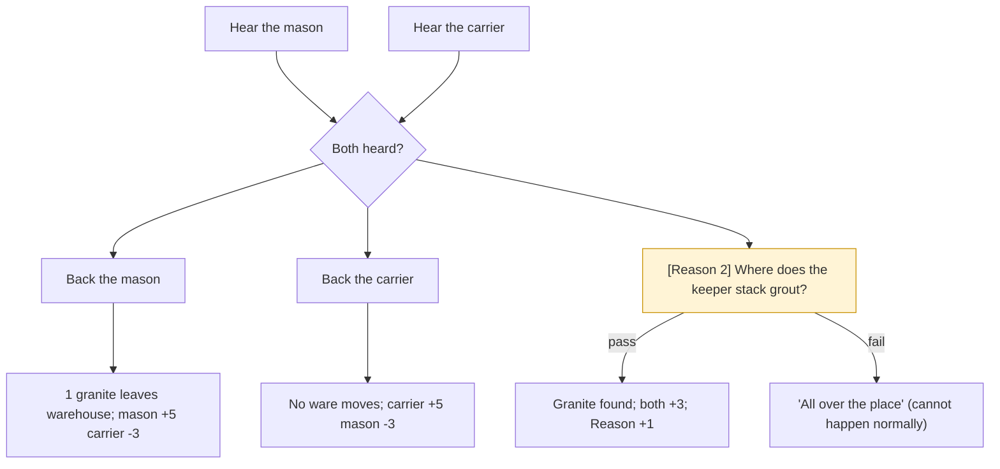

# The Missing Granite (quest)

Collection CV-GRANITE. A mason says a load of granite never arrived; a carrier says it did. The only village decision that changes a real ware.

## The story at a glance

```text
Hear the mason ......... ‘Tell me about the stone.’
Hear the carrier ....... ‘What happened to the sixth load?’
        │ (both heard)
        ├── Mason: ‘I believe you. I will ask the keeper for a load from the store.’
        │      → ONE GRANITE leaves the home warehouse · mason +5, carrier −3 · journal note · conversation ends
        ├── Carrier: ‘I believe you. The mason can fetch the stone again.’
        │      → nothing moves · carrier +5, mason −3 · no journal note · conversation ends
        └── Carrier: [Reason, easy 2] ‘Grout sacks, you said. Where does the keeper stack grout?’
               PASS (always for a normal apprentice: 2 +1 evidence = 3) → the load was under the grout
                    both +3 · Reason +1 · ledger ‘found_the_granite’ · journal note · ends
               FAIL → ‘All over the place, that morning.’ (unreachable in normal play)
(two wizards who each back the mason cost the warehouse two loads: DEF-17)
```




**What each person says on entry, in order (the first entry whose conditions hold is spoken; the rest are ignored)**

*Mason*

| # | Entry | Speaks when | First line |
|---|-------|-------------|------------|
| 1 | `v-m_done_mason` | “you backed the mason (the warehouse gave up a load of granite)” has happened; “the mason has spoken his closing reaction” has NOT happened | Granite from the store, on your word. I will not forget who stood up for me, wizard. The… |
| 2 | `v-m_done_hauler` | “you backed the carrier” has happened; “the mason has spoken his closing reaction” has NOT happened | You took {hauler}'s word over mine. Fine. I will fetch my own stone from now on, and the… |
| 3 | `v-m_done_found` | “you worked out the granite was under the grout sacks” has happened; “the mason has spoken his closing reaction” has NOT happened | Under the grout sacks. The whole time. I owe {hauler} a word, and you a drink. |
| 4 | `v-m_after` | “the mason has spoken his closing reaction” has happened | Stone is stone. We are past it. |
| 5 | `v-m_open` | otherwise (entry 5 of 5; the first one whose conditions hold is spoken) | Do you see this wall? No, you do not, because there is no wall, because there is no grani… |

*Carrier*

| # | Entry | Speaks when | First line |
|---|-------|-------------|------------|
| 1 | `v-h_done_mason` | “you backed the mason (the warehouse gave up a load of granite)” has happened; “the carrier has spoken their closing reaction” has NOT happened | So the store pays for what I carried and {mason} gets to call me a liar for free. Good to… |
| 2 | `v-h_done_hauler` | “you backed the carrier” has happened; “the carrier has spoken their closing reaction” has NOT happened | Thank you. Nobody believes a carrier. We only walk the roads all day, what would we know… |
| 3 | `v-h_done_found` | “you worked out the granite was under the grout sacks” has happened; “the carrier has spoken their closing reaction” has NOT happened | Under the grout. I put it there myself and forgot; the keeper had me stacking grout all m… |
| 4 | `v-h_after` | “the carrier has spoken their closing reaction” has happened | Roads to walk. Was there something? |
| 5 | `v-h_open` | otherwise (entry 5 of 5; the first one whose conditions hold is spoken) | If this is about the granite, I carried it. In through the north door, down on the floor,… |


## Detailed choice tree (generated from the game's data)

Read each line as: **[Aspect, difficulty number]** is a skill check; `needs`/`after`/`not if` are the conditions that decide whether the choice is offered; `says` is the first line of the response; `effects` are the lasting consequences. A child is shown under the choice that makes it available.

```text
■ The mason (mason)
├── “Tell me about the stone.”
│   │   · not if: you have heard the mason's side
│   │   · says: “Six loads were due from the quarry. Five came. {hauler} carried the sixth, {hauler} says. I have fi…”
│   │   · effects: Set “you have heard the mason's side”
│   └── “I believe you. I will ask the keeper for a load from the store.”
│           · after: you have heard the mason's side; you have heard the carrier's side
│           · not if: you backed the mason (the warehouse gave up a load of granite); you backed the carrier; you worked out the granite was under the grout sacks
│           · says: “Then I will stop shouting. Thank you.”
│           · effects: Set “you backed the mason (the warehouse gave up a load of granite)”; Warehouse: -1 granite (moved through the economy’s own ledger) [once]; Ledger count ‘sided_with_mason’ +1
│           · → conversation ends
└── “I will let you work.”
        · says: “Such as it is.”
        · → conversation ends

■ The carrier (hauler)
├── “What happened to the sixth load?”
│   │   · not if: you have heard the carrier's side
│   │   · says: “I carried it. The keeper was shouting about grout sacks that morning, everything went everywhere, b…”
│   │   · effects: Set “you have heard the carrier's side”
│   ├── “I believe you. The mason can fetch the stone again.”
│   │       · after: you have heard the mason's side; you have heard the carrier's side
│   │       · not if: you backed the mason (the warehouse gave up a load of granite); you backed the carrier; you worked out the granite was under the grout sacks
│   │       · says: “Then I will walk a little lighter today.”
│   │       · effects: Set “you backed the carrier”; Ledger count ‘sided_with_hauler’ +1
│   │       · → conversation ends
│   └── [Reason, easy 2] “Grout sacks, you said. Where does the keeper stack grout?”
│           · after: you have heard the mason's side; you have heard the carrier's side
│           · not if: you backed the mason (the warehouse gave up a load of granite); you backed the carrier; you worked out the granite was under the grout sacks
│           · says: “{name} frowns.”
│           · check: Reason easy (2); evidence: +1 “you have heard the mason's side” has happened
│           · PASS → “By the north door. Where I put the... oh. Oh, no. Under the grout. It will be under the g…” · ends · Set “you worked out the granite was under the grout sacks”; Ledger count ‘found_the_granite’ +1; Reason +1 (once only) [once]
│           · FAIL → “All over the place, that morning. I could not tell you.” · stays in the conversation; button greyed until the score, evidence or regard changes
└── “I will let you get on.”
        · says: “Roads do not walk themselves.”
        · → conversation ends
```
