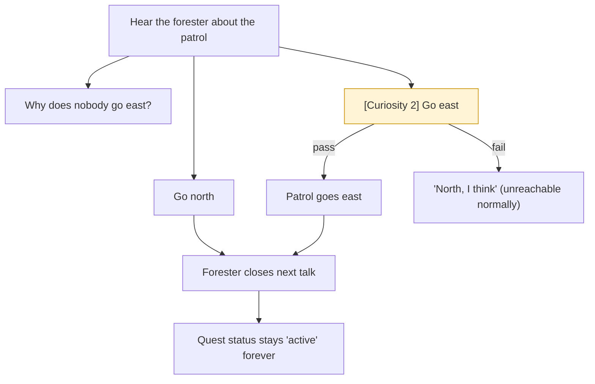

# The Patrol (quest)

Collection CV-PATROL. A forester prepares a patrol of the valley's edge. The guard (a soldier, else hunter/lumberjack) is optional. This is where the Trial is first spoken of.

## The story at a glance

```text
Hear the forester ........ ‘Which way are you thinking?’ (north fences or east road)
        ├── ‘Why does nobody go east?’ ... the Trial gate, learns ‘trial_rumour’ (nothing reads it)
        ├── ‘Go north.’ .................. patrol_north · forester agrees · ends
        └── [Curiosity, easy 2] ‘Go east, and look at the road…’
               PASS (Curiosity 3) → agrees to count contestants; patrol_east · ends
               FAIL → ‘North, I think.’ (cannot happen: Curiosity never falls below 3)
The guard: if the patrol went east he says ‘<forester> is off east tonight on your say-so…’; otherwise he warns against the east road.
The quest NEVER reaches ‘done’ (needs two closing flags; the guard never sets one: DEF-03).
```




**What each person says on entry, in order (the first entry whose conditions hold is spoken; the rest are ignored)**

*Forester*

| # | Entry | Speaks when | First line |
|---|-------|-------------|------------|
| 1 | `v-r_done` | “a patrol route has been chosen” has happened; “the forester has spoken the closing reaction” has NOT happened | I have the route in my head now. Thank you for thinking it through with me; most people j… |
| 2 | `v-r_after` | “the forester has spoken the closing reaction” has happened | Back from the edge. Nothing out there but trees and the road, which is how I like it. |
| 3 | `v-r_open` | otherwise (entry 3 of 3; the first one whose conditions hold is spoken) | I walk the edge of the valley every few days: the fences, the trees, the road. I am going… |

*Guard*

| # | Entry | Speaks when | First line |
|---|-------|-------------|------------|
| 1 | `v-g_east` | “you advised sending the patrol east” has happened | {ranger} is off east tonight on your say-so. If they come back talking about gates and go… |
| 2 | `v-g_open` | otherwise (entry 2 of 2; the first one whose conditions hold is spoken) | If {ranger} asks which way to walk, say north. Nothing good comes up that east road. Last… |


## Detailed choice tree (generated from the game's data)

Read each line as: **[Aspect, difficulty number]** is a skill check; `needs`/`after`/`not if` are the conditions that decide whether the choice is offered; `says` is the first line of the response; `effects` are the lasting consequences. A child is shown under the choice that makes it available.

```text
■ The forester (patrol) (ranger)
├── “Which way are you thinking?”
│   │   · not if: you have heard the forester talk about the patrol
│   │   · says: “North along the fences, where the deer get in. Or east along the road, past where the old fortress…”
│   │   · effects: Set “you have heard the forester talk about the patrol”
│   ├── “Why does nobody go east?”
│   │       · after: you have heard the forester talk about the patrol
│   │       · not if: the forester told you about the Trial gate
│   │       · says: “The Trial. The fortress in the hills has a gate, and once a year the gate opens and people walk in…”
│   │       · effects: Set “the forester told you about the Trial gate”; You learn: trial_rumour [once]
│   ├── “Go north. The fences matter more than the road.”
│   │       · after: you have heard the forester talk about the patrol
│   │       · not if: a patrol route has been chosen
│   │       · says: “North it is. The deer will be disappointed.”
│   │       · effects: Set “a patrol route has been chosen”; Set “you advised sending the patrol north”
│   │       · → conversation ends
│   └── [Curiosity, easy 2] “Go east, and look at the road. Tell me what you see at the gate.”
│           · after: you have heard the forester talk about the patrol
│           · not if: a patrol route has been chosen
│           · says: “{name} looks at you for a moment.”
│           · check: Curiosity easy (2); evidence: none
│           · PASS → “All right. East. If there are contestants on the road I will count them for you. Do not g…” · ends · Set “a patrol route has been chosen”; Set “you advised sending the patrol east”; You learn: trial_rumour [once]; Curiosity +1 (once only) [once]
│           · FAIL → “East is the road and the road is the Trial and I would rather not. North, I think.” · stays in the conversation; button greyed until the score, evidence or regard changes
└── “I will let you get ready.”
        · says: “Dusk, then.”
        · → conversation ends

■ The guard (guard)
├── “A man in a black cloak? Asking after whom?”
│       · not if: the forester told you about the cloaked stranger
│       · says: “After {mentor}. By name, and an old name at that. He thanked me, which I did not like, and went bac…”
│       · effects: Set “the forester told you about the cloaked stranger”; You learn: stranger_rumour [once]
└── “Keep your eyes open.”
        · says: “Always do.”
        · → conversation ends
```
