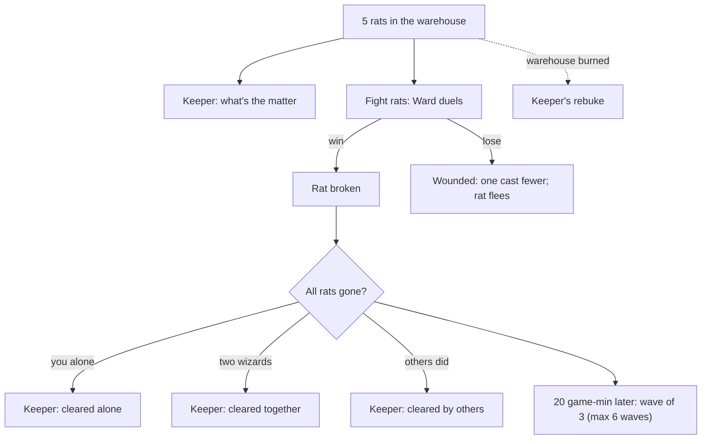

# The warehouse keeper and the rats

Collection CV-WAREHOUSE. Five rats (one big) live in the home warehouse and eat its food. The keeper's words follow what the rats and the wizards have done.

## The story at a glance

```text
Rats alive (5, one big)
│
├── Ask ‘What's the matter with the warehouse?’ .. keeper's complaint is recorded; Mira (single player) starts helping
├── ‘Those are not rats. They are machines.’ ..... once; then ‘Six legs. Metal. It clicked at me.’ (once)
├── Fight a rat (stand within 2 tiles): win → rat gone; lose → one cast fewer next duel, rat scurries off
│
└── Keeper's greeting changes with the facts:
      burned warehouse · duelling instead of fighting · cleared together · cleared alone · cleared by others · cleared (any)
      · wave 2+ returns (smaller, 3 rats, 20 game-minutes after clearing, up to 6 waves) · progress report · first complaint · quiet
Also: the mentor's log (see the mentor diagram) · with no logs in the store two identical buttons appear (DEF-04)
```




**What each person says on entry, in order (the first entry whose conditions hold is spoken; the rest are ignored)**

*Warehouse keeper*

| # | Entry | Speaks when | First line |
|---|-------|-------------|------------|
| 1 | `v-burned` | “the keeper has spoken of the burned warehouse” has NOT happened; burned (1 if the warehouse was burned) is at least 1 | You set fire to my warehouse. With the rats still in it. I want you to think about the or… |
| 2 | `v-duelling_instead` | “the keeper has complained that you duelled instead of fighting rats” has NOT happened; complained (1 if the keeper has complained to a wizard) is at… | I have been standing here listening to the pair of you throw Wards at each other in the r… |
| 3 | `v-cleared_together` | “the keeper has spoken about the cleared rats” has NOT happened; cleared (1 if the current infestation is cleared) is at least 1; cooperated (1 if th… | Both of you, then. One on each side of the store, like you had planned it. I did not expe… |
| 4 | `v-cleared_alone` | “the keeper has spoken about the cleared rats” has NOT happened; cleared (1 if the current infestation is cleared) is at least 1; my_killed (rats thi… | All of them, and all by you, while your friend did whatever your friend does. I noticed.… |
| 5 | `v-cleared_by_others` | “the keeper has spoken about the cleared rats” has NOT happened; cleared (1 if the current infestation is cleared) is at least 1; my_killed (rats thi… | Rats are gone. Not by your hand, from what I saw, but gone. I thank whoever did it; I exp… |
| 6 | `v-cleared_any` | “the keeper has spoken about the cleared rats” has NOT happened; cleared (1 if the current infestation is cleared) is at least 1 | That is the last of them. Good riddance. The store is open. |
| 7 | `v-returned` | wave (which wave of rats this is) is at least 2; pests_left (rats still alive) is at least 1; complained (1 if the keeper has complained to a wizard)… | They are back. Fewer this time, and bolder. I told the elders we needed a cat; they said… |
| 8 | `v-progress` | complained (1 if the keeper has complained to a wizard) is at least 1; pests_left (rats still alive) is at least 1; killed_total (rats killed so far… | {killed_total} down, {pests_left} to go. They eat faster than you fight; {eaten_total} lo… |
| 9 | `v-complaint` | pests_left (rats still alive) is at least 1 | Rats. In the Central Warehouse. {pests_total} of them at the last count, in and out of th… |
| 10 | `v-quiet` | otherwise (entry 10 of 10; the first one whose conditions hold is spoken) | Store is quiet. Which is how I like it. Ask the carriers if you want news; I only count t… |


## Detailed choice tree (generated from the game's data)

Read each line as: **[Aspect, difficulty number]** is a skill check; `needs`/`after`/`not if` are the conditions that decide whether the choice is offered; `says` is the first line of the response; `effects` are the lasting consequences. A child is shown under the choice that makes it available.

```text
■ The warehouse keeper (keeper)
├── “What's the matter with the warehouse?”
│       · needs: pests_left (rats still alive) is at least 1
│       · says: “I just told you. Rats. They go for the rations first, then the bread, then whatever smells of eithe…”
│       · effects: Ledger count ‘keeper_complained_to’ +1; The keeper’s complaint about the rats is recorded
├── “Those are not rats. They are machines. Look at the legs.”
│       · needs: pests_left (rats still alive) is at least 1
│       · single use
│       · says: “They are rats. I have been keeper of this store for eleven years and I know a rat when it eats my g…”
│       · effects: Ledger count ‘keeper_told_machines’ +1
├── “Six legs. Metal. It clicked at me.”
│       · needs: pests_left (rats still alive) is at least 1; keeper_told_machines (times a wizard told the keeper the rats are machines) is at least 1
│       · single use
│       · says: “A rat with opinions, then. Put it down all the same.”
├── “My teacher needs a log for the brazier. Could the store spare one?”
│       · needs: you have learned: the mentor asked you for a log for his brazier; you have NOT learned: you brought the mentor a log (set by the keeper)
│       · says: “For {mentor}? Take one. Take it from the dry stack, not the green. And tell them the account is ope…”
│       · effects: Warehouse: -1 log (moved through the economy’s own ledger) [once]; You learn: you brought the mentor a log (set by the keeper) [once]; Regard of the speaker for you +2 [once]
├── “My teacher needs a log for the brazier. Could the store spare one?”
│       · needs: logs (logs in the settlement's warehouses) is at most 0; you have learned: the mentor asked you for a log for his brazier; you have NOT learned: you brought the mentor a log (set by the keeper)
│       · says: “Not a log in the place. Ask the lumberjack, or wait for the carriers.”
└── “I'll leave you to it.”
        · says: “Mind the boards.”
        · → conversation ends
```
