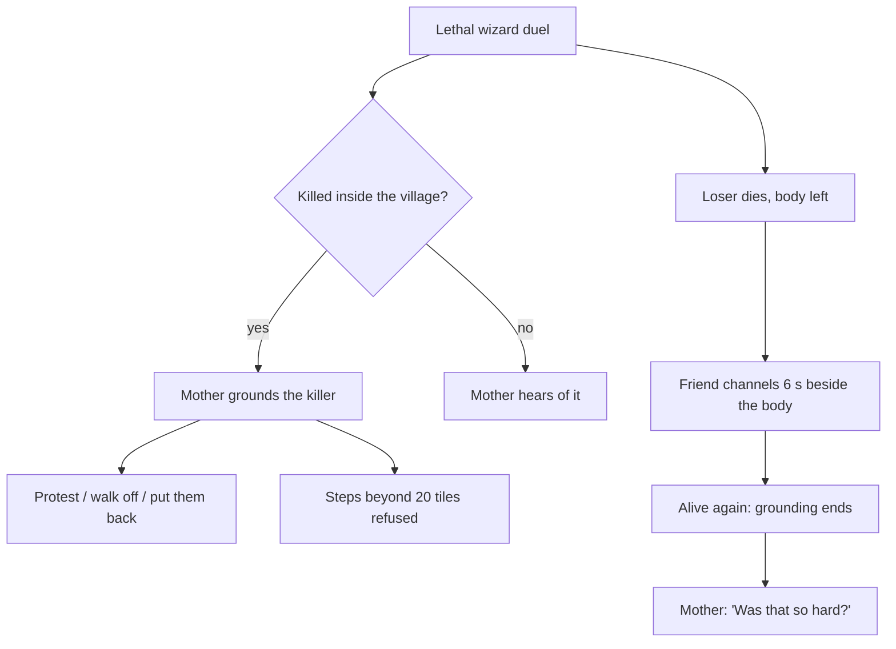

# Death, resurrection and the mother

Collections CV-MOTHER and CV-SYSTEM. Apprentices are mortal. A wizard who loses a lethal duel dies and leaves a body; a living wizard standing beside it can channel for 6 seconds to bring them back. A wizard who kills a friend inside the village is grounded by their mother.

## The story at a glance

```text
Wizard duel (to the death)
│
├── Loser dies: body, tombstone, ledger deaths+1 ... the dead can only watch
├── Killer's ledger kills+1 ... mother.on_death:
│     ├── death INSIDE 20 tiles of the village → mother walks over and speaks; GROUNDED
│     │     ├── ‘It was a duel. They agreed to it.’ → ‘I don't care who started it. Resurrect them.’ (protest counted)
│     │     ├── ‘And if I just walk off?’ → ‘…every road out of this village has me standing in it.’ (protest counted)
│     │     └── ‘I'll put them back.’ → ends
│     │     Every step beyond 20 tiles, and the Trial gate, is refused in her words (three lines, changing every 3 attempts)
│     └── death OUTSIDE → she only hears of it; no grounding
└── Resurrection: stand within 2 tiles, channel 6 s; walking away abandons it
      ├── friend returns with spells, lessons, facts, regard · grounding ends
      ├── the resurrector's mother: ‘There. Was that so hard?’
      └── the victim's mother: ‘You died. I want you to know that I knew.’
Dying to the stranger's duel: game over (a private session ends; in company the others go on).
```




**What each person says on entry, in order (the first entry whose conditions hold is spoken; the rest are ignored)**

*Mother*

| # | Entry | Speaks when | First line |
|---|-------|-------------|------------|
| 1 | `v-grounded_third` | grounded (1 if the mother is keeping her child at home) is at least 1; kills (wizards killed by another wizard in this world) is at least 3 | I have stopped counting. {victim} is dead again, and you are standing there with that fac… |
| 2 | `v-grounded_second` | grounded (1 if the mother is keeping her child at home) is at least 1; kills (wizards killed by another wizard in this world) is at least 2 | You have killed your friend? Again? Well. You are not going anywhere until you put them b… |
| 3 | `v-grounded_protested` | grounded (1 if the mother is keeping her child at home) is at least 1; protests (times a wizard protested to the mother after killing a friend) is at… | I heard you the first time. A fair duel. Everybody agreed. Very proper. |
| 4 | `v-grounded_first` | grounded (1 if the mother is keeping her child at home) is at least 1 | {child}. Come here. No, here. Look at me. |
| 5 | `v-thanks` | “the mother has thanked you for bringing a friend back” has NOT happened; resurrections (wizards brought back from the dead in this world) is at leas… | There. Was that so hard? Now the pair of you go and be useful, and if I see another body… |
| 6 | `v-been_dead` | “the mother has mourned with you after you died” has NOT happened; deaths (wizard deaths in this world) is at least 1 | You died. I want you to know that I knew. A mother knows. I was fetching water and the bu… |
| 7 | `v-told_news` | “the mother has told you the news” has NOT happened; mentor_dead (1 if the mentor has been killed) is at least 1; arrived_after (1 if the child joine… | Where were you? No, do not tell me. While you were off wherever you were, a stranger in a… |
| 8 | `v-newcomer` | “the mother has told you the news after you arrived late” has NOT happened; arrived_after (1 if the child joined the world after the mentor died) is… | You came to us after it all happened. {mentor} is dead: killed in the square by a strange… |
| 9 | `v-ordinary` | otherwise (entry 9 of 9; the first one whose conditions hold is spoken) | Have you eaten? You have not eaten. Wizards forget to eat, that is how they get thin and… |


## Detailed choice tree (generated from the game's data)

Read each line as: **[Aspect, difficulty number]** is a skill check; `needs`/`after`/`not if` are the conditions that decide whether the choice is offered; `says` is the first line of the response; `effects` are the lasting consequences. A child is shown under the choice that makes it available.

```text
■ The mother (mother)
├── “It was a duel. They agreed to it.”
│       · needs: grounded (1 if the mother is keeping her child at home) is at least 1
│       · says: “I don't care who started it. Resurrect them.”
│       · effects: Ledger count ‘protests’ +1
├── “And if I just walk off?”
│       · needs: grounded (1 if the mother is keeping her child at home) is at least 1
│       · says: “Then you will find that every road out of this village has me standing in it. I raised you. I know…”
│       · effects: Ledger count ‘protests’ +1
├── “I'll put them back.”
│       · needs: grounded (1 if the mother is keeping her child at home) is at least 1
│       · says: “Good. Stand next to them and do whatever it is you do. I will be watching from the window, so do it…”
│       · → conversation ends
├── “How are you?”
│       · needs: grounded (1 if the mother is keeping her child at home) is at most 0
│       · says: “Old. Busy. Proud, mostly, though I would not say it to your face. Go on, you have a village to see…”
│       · → conversation ends
└── “I have to go.”
        · needs: grounded (1 if the mother is keeping her child at home) is at most 0
        · says: “Go on then. Come back for supper.”
        · → conversation ends
```
