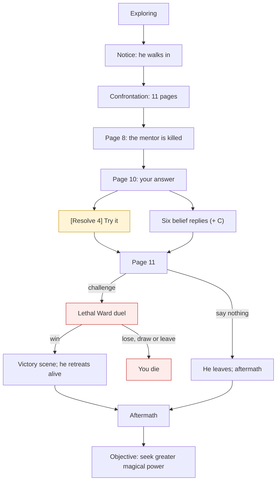

# The stranger: arrival, confrontation, duel and retreat

Collection CV-STRANGER. Scripted scenes: pages the player acknowledges one at a time. The world keeps running until a page needs the player; the clock pauses only during scenes and the duel.

## The story at a glance

```text
Exploring (3 min + 3 contacts, or 7 min whatever happened; nothing else open)
│
▼
NOTICE (1 page) ‘A stranger in a dark travelling cloak is walking into <village>…’ → he walks in
│
▼
CONFRONTATION (11 pages)                               [or ALONE (5 pages) if the mentor is already gone]
  1 narrator: the mentor takes up the staff            (multiplayer: a wizard arriving mid-scene)
  2-6 mentor and stranger argue (Harrowmere, power as a licence, ‘No.’)
  7 narrator: the light opens like a door
  8 narrator: the mentor falls                         ← THE MENTOR IS KILLED (a real death, once, even if nobody reads it)
  9 narrator: ‘For the first time he sees you.’
 10 stranger speaks to you (line chosen by your history: kills, duels, deaths, lessons, Mira)
      your answer:
        ├── [Resolve, demanding 4] ‘Try it.’ ... PASS needs hidden-Ward lesson +1 and creed answer +1 (2+1+1=4): fact ‘stood_firm’
        │                                         FAIL: ‘Your voice shakes…’ (no penalty); his reply is the same either way
        └── six belief replies (S A R D G M) + C with the mentor's old-craft secret
              he agrees with S; neutral to A, G, C; disagrees with R, D, M
 11 stranger: ‘I am not a butcher, and you are not enough…’
        ├── ‘Then prove it. Ward against Ward, here, now.’ ──► LETHAL DUEL (3 colours, 3 places; you get 12 casts, he gets 8)
        │       ├── you break his Ward ──► VICTORY (4 pages): he retreats alive · Resolve +1 · journal note · others spared
        │       └── you lose / draw / leave the board ──► YOU DIE (a draw counts as defeat)
        └── ‘(Say nothing. Let him go.)’ ──► he leaves; no duel; no Resolve gain
▼
AFTERMATH: villagers react (see the aftermath diagram); after 2 conversations or 150 s:
  journal ‘Objective: seek greater magical power.’  → stage ‘complete’
```




## Pages and answers (exact order)

- **notice** (1 pages, then ‘arrival’)
- **confrontation** (11 pages, then ‘departure’)
- **confrontation_alone** (5 pages, then ‘departure’)
- **victory** (4 pages, then ‘aftermath’)
