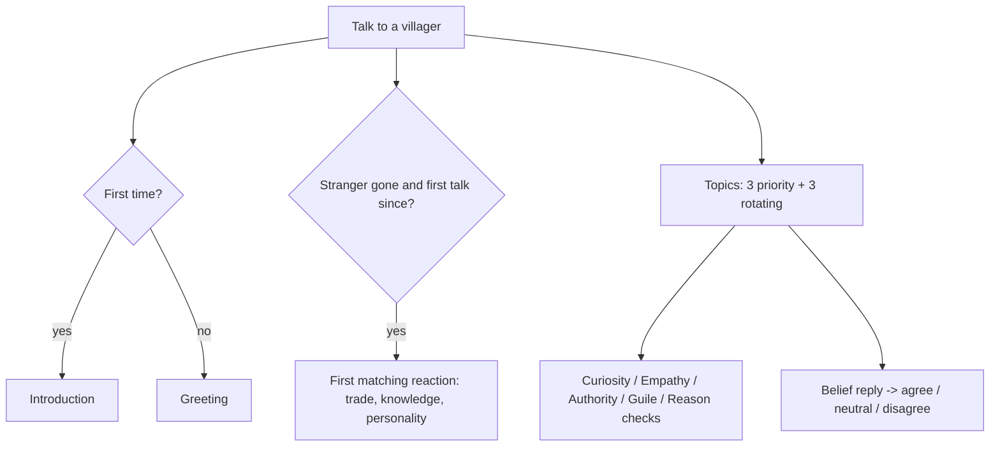

# After the stranger, and everyday talk

Collections CV-AFTER and CV-EVERYDAY. Dynamic dialogue: what an ordinary villager says depends on their trade, personality, what they saw, the live simulation, and how often you have spoken to them.

## The story at a glance

```text
Talk to any villager
│
├── first time ever ........ introduction (1 of 2 wordings, seeded draw)
├── later .................. greeting (1 of 3-4 wordings, seeded draw)
├── after the stranger has gone, FIRST talk only:
│     the first matching REACTION (table below) by trade → knowledge (saw him / heard of him) → personality
└── topics (up to 3 priority + 3 rotating; hidden if their conditions fail)
      ├── ‘What happened here today?’ (witnessed vs rumour wording)
      ├── ‘How are you taking it?’ + six belief replies: they agree/neutral/disagree by their own worldview
      ├── [Curiosity 4] ‘Did anyone know him?’ → PASS (needs +1 evidence: you witnessed, or know the old craft): Harrowmere clue
      ├── [Empathy 2] sympathy topic (fond villagers) → PASS: regard +6
      ├── [Authority 2] ‘Report, soldier.’ (soldiers who saw him) → needs +1 (stood_firm)
      ├── [Guile 2] ‘Confirm it for me’ → needs +1 (Harrowmere clue); FAIL: regard −2
      ├── [Reason 2] ‘Tell me exactly what you saw.’ (proud/blunt rumour-bearers) → PASS
      ├── ‘Where could I learn more?’ → advice by the villager's worldview (D grove, R cloister, G guild-school, M court-mage, S master, A open road, C the pattern)
      └── trade questions (trees, timber, stone, game, cargo, soldiers, barracks…) that appear only when true in the world
```




## The first reactions, in the order they are tried

| # | Reaction id | Trade | Knowledge | Personality needed |
|---|-------------|-------|-----------|--------------------|
| 1 | `soldier_w` | soldier | witnessed | — |
| 2 | `soldier_r` | soldier | rumour | — |
| 3 | `ranger_w_fond` | ranger | witnessed | speaker’s attitude to the mentor is fond |
| 4 | `ranger_any` | ranger | any | — |
| 5 | `lumberjack_w` | lumberjack | witnessed | — |
| 6 | `lumberjack_r` | lumberjack | rumour | — |
| 7 | `carrier_any` | carrier | any | — |
| 8 | `hunter_any` | hunter | any | — |
| 9 | `stone_any` | stonemason | any | — |
| 10 | `w_fond` | any | witnessed | speaker’s attitude to the mentor is fond |
| 11 | `w_wary` | any | witnessed | speaker’s attitude to the mentor is wary |
| 12 | `w_any` | any | witnessed | — |
| 13 | `r_fond` | any | rumour | speaker’s attitude to the mentor is fond |
| 14 | `r_any` | any | rumour | — |

A reaction line can itself carry sub-lines that appear only for certain personalities (for example a ‘wary’ remark when regard is 5 or less).
