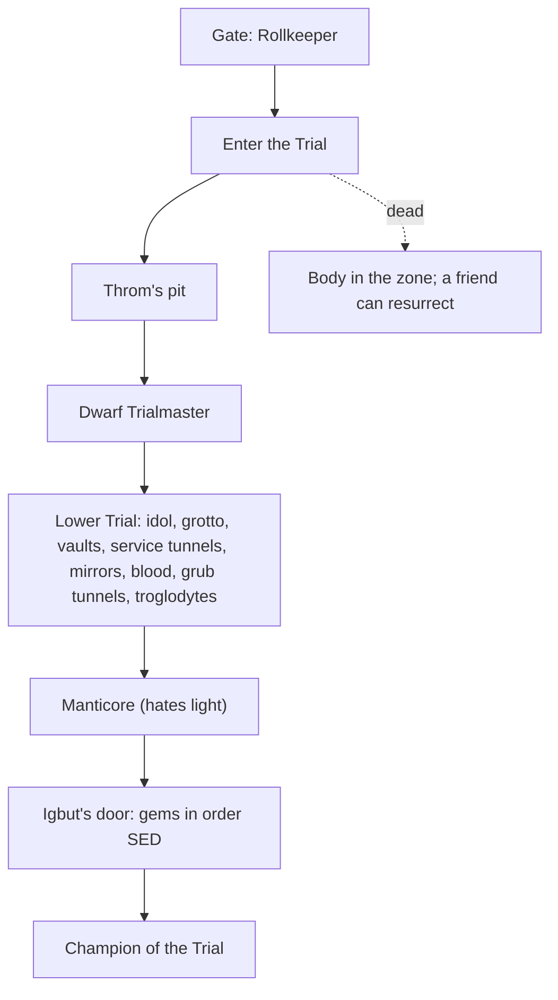

# The Trial of Champions: the gate and the choice events

Collections CV-TRIALGATE and CV-TRIAL. The Rollkeeper registers contestants at the gate; inside, 15 choice events (ported from the book) shape the run. Run state is shared by every wizard in the run.

## The story at a glance

```text
Gate: the Rollkeeper (reads your history)        Inside the Trial (17 zones)
 ├── ‘What is the Trial?’ (once)                    Throm at the pit ........ lowered / lower him / jump / alone → ally, betrayed, wounded
 ├── [Empathy] ‘Any advice?’                         Black book vial ......... drink (poisoned) / rub (heals a wound) / leave
 ├── ‘I am going in.’ (if unprepared)                Dwarf Trialmaster ....... accept or attack with Throm → dice (no consequence) → cobra → map, learn Stone
 ├── ‘Why write it down at all?’ (fourth wall)       Dying elf ............... stay or take the charm → ‘the real diamond is cold’
 └── warnings for killers, unprepared, returners     Idol's false eye ........ take (wakes the second guardian)
                                                     False diamond ........... take (wound, vault locks)
Contestants (talk only): knight Serra,               Starved man ............. free (Bloodbeast hates Vine)
 elven woman, Throm, barbarian, figure in black      Poison Ivy's toll ....... torch / leave / attack (lethal duel)
                                                     Basket man .............. needs Ivy paid or the prisoner freed
                                                     Mirrors ................. smash (no duel) / leave
                                                     Boulder ................. run / brace with Stone / hold (wound)
                                                     Trapped chest ........... jam with Stone / side / head-on (wound)
                                                     Troglodyte rite ......... join / run / attack (duel)
                                                     Igbut's door ............ place gems; SED wins; 3 wrong orders scatter the gems
```




## Every choice event, branch by branch (from runtime check P38)

```text
■ statue_riddle
   ├── (open): A knight went first. She counted the steps from the door to this stone; she said it aloud so I would remember…
   ├── 100: No. Listen better; the Trial will not ask twice. He raps your knuckles with his staff, hard enough to numb th…   ⟶ condition: wounded
   ├── 150: A hundred and fifty. She could count; it did not save her. So I will tell you one thing for it. The lion-thin…
   ├── 200: No. Listen better; the Trial will not ask twice. He raps your knuckles with his staff, hard enough to numb th…   ⟶ condition: wounded
   ├── (open) [flags={'riddle_answered': True, 'riddle_right': True}]: You read. Good. The lion-thing below hates the light for the same reason.
   ├── (open) [flags={'riddle_answered': True}]: The stone keeps its own counsel. So do I, now.
■ throm_pit
   ├── (open): A pit cuts the corridor. Far below, water moves. The far edge is a long jump, or a rope's length, if someone…
   ├── lowered: Throm: "Down you go, villager. I have held worse."
   ├── lower_him: Throm: "...Throm. My name is Throm. Take the rope, then. Tightly." You lower Throm by the rope. He looks very…
   ├── alone [pockets=['torch']]: You take the wall alone. Halfway, the wall takes you. You land in the shallows, hard. You are hurt: one cast…   ⟶ condition: wounded
   ├── jump: You jump together, land hard, and laugh until it hurts. (It hurts. You are hurt: one cast fewer in your next…   ⟶ condition: wounded
   ├── after_him [flags={'pit_throm_below': True}]: Throm: "Hah. An honest villain would have left. Come on."
   ├── leave_him [flags={'pit_throm_below': True}]: You cross alone. Behind you, the rope goes still. You will remember this.
   ├── (open) [flags={'pit_crossed': True}; throm=uneasy_ally]: The rope is tied off below. Throm went down first; the knots are his. Climb when you like.
   ├── (open) [flags={'pit_crossed': True}; throm=betrayed]: The rope hangs slack into the dark. Nobody is holding it. You crossed alone, and you will remember this.
   ├── (open) [flags={'pit_crossed': True}; throm=wounded]: The rope is tied off below. Throm is down there somewhere, favouring one arm.
■ black_book
   ├── (open): Throm: "Don't. Whatever it is, don't."
   ├── drink: It tastes of ink and lightning. Your hands shake. You are poisoned: your next casts will come slower than you…   ⟶ condition: poisoned
   ├── rub: It burns cold. Where it touches, the skin knits a little, though there was nothing much to knit.
   ├── rub [flags={}]: It burns cold. Where it touches, the skin knits a little, though there was nothing much to knit.
   ├── leave: You stopper the vial and leave it. Some things stay unknown.
   ├── (open) [flags={'potion_used': True}]: The vial is empty now.
■ dwarf_meet
   ├── (open): Dwarf: "Locked in, both of you. Only one continues; that is the procedure. The Trialmaster at your service: l…
   ├── accept: Dwarf: "Through here. Mind the cobra." Dwarf: "Two dice in the cup. When they land: the same as eight, less,…
   ├── attack [flags={'pit_ally': True}]: Dwarf: "Oh, we do this every Trial." Something clicks. Throm sits down suddenly, holding his head. "We do it…   ⟶ condition: wounded
   ├── same [flags={'trial_started': True}]: Dwarf: The cup lifts: 10. "Wrong. But you understood the question, which is the point." Dwarf: "Last: the bas…
   ├── less [flags={'trial_started': True}]: Dwarf: The cup lifts: 10. "Wrong. But you understood the question, which is the point." Dwarf: "Last: the bas…
   ├── more [flags={'trial_started': True}]: Dwarf: The cup lifts: 10. "Hm. Luck or arithmetic." Dwarf: "Last: the basket. Hold its gaze, or snatch it. Ch…
   ├── gaze [flags={'trial_started': True, 'trial_dice': True}]: You hold its gaze until it looks away first. The Dwarf writes something down. Dwarf: "Procedure complete. You…
   ├── snatch [flags={'trial_started': True, 'trial_dice': True}]: Fast, but fangs graze your wrist. You are hurt: one cast fewer in your next duel. Dwarf: "Procedure complete.…   ⟶ condition: wounded
   ├── gaze [flags={'trial_started': True, 'trial_dice': True, 'pit_betrayed': True}]: You hold its gaze until it looks away first. The Dwarf writes something down. Dwarf: "Procedure complete. You…
■ elf_rescue
   ├── (open): Dying elf: "...help... the snake... first..."
   ├── (open) [defeated=[['dd_grotto', 'boa_grotto1']]]: The snake loosens. The elven woman breathes, barely. She is fading.
   ├── stay [defeated=[['dd_grotto', 'boa_grotto1']]]: You hold her hand while she tells you: the final door wants gems, and one of them is a diamond. The real one…
   ├── take [defeated=[['dd_grotto', 'boa_grotto1']]]: You take the charm. Her voice follows you out: the final door wants gems, one is a diamond, and the real one…
   ├── (open) [defeated=[['dd_grotto', 'boa_grotto1']]; flags={'elf_gone': True}]: She is gone. The hollow smells of bread and dust.
■ false_eye
   ├── (open): The east eye glitters. Bigger. Greener. The scratched warnings around the base were about this one.
   ├── take: It comes away in your hand, glass, flawed glass, and every bird on the idol turns its head at once. The secon…   ⟶ FIGHT flying_guardian
   ├── take [defeated=[['dd_idol', 'guard_idol2']]]: Nothing else moves. You are holding a piece of green glass in a room full of dead birds.
   ├── leave: You leave it where it lies.
   ├── (open) [flags={'picked_false_eye': True}]: A socket, empty, and a room full of dead birds.
■ false_diamond
   ├── (open): You remember the elf: the real one is cold. This one has been lying under a lamp. A diamond beside a fallen w…
   ├── (open) [fact=diamond_is_cold]: You remember the elf: the real one is cold. This one has been lying under a lamp. A diamond beside a fallen w…
   ├── take: The floor opens its eye. A blade you never see draws a line across your arm, and somewhere behind you an iron…   ⟶ condition: wounded
   ├── leave: You leave it where it lies.
■ free_prisoner
   ├── (open): Starved man: "...failed... they took my eyes... no, my boots..."
   ├── free: You cut his bonds. He presses something into your hand, bitter herbs, and babbles about the beast below. Star…
   ├── leave: You leave him. The dark keeps him.
   ├── (open) [flags={'prisoner_free': True}]: Starved man: "Go. Stones. It loves... no. It HATES the green. Vine. Its eyes water."
■ ivy_toll
   ├── (open): Poison Ivy: "Tribute, sweetling. Something useful, or thorns."
   ├── torch [pockets=['torch']]: Poison Ivy: "A torch? For me? ...Walk soft, sweetling. Walk soft."
   ├── leave: You leave her thorns alone.
   ├── attack: The thorns come up all at once.   ⟶ FIGHT poison_ivy
■ basket_ride
   ├── (open): Basket man: "Rope's for staff and for people Ivy likes. You're neither, yet. Sort her out, or sort out the po…
   ├── (open) [flags={'ivy_paid': True}]: Basket man: "Heard what you did. Right. The rope goes up to the vault's back room and comes down again; use t…
   ├── (open) [flags={'prisoner_free': True, 'basket_ok': True}]: Basket man: "Shaft's at the south wall. Up or down, same fare: none."
■ mirror_smash
   ├── (open): Tall mirrors, silver-backed. Something moves in them a breath after you do.
   ├── smash: Silver rain. The thing in the glass never finishes stepping out. (The Mirror Demon is broken without a duel.…
   ├── leave: You leave the glass its dignity.
   ├── (open) [defeated=[['dd_mirror', 'demon_mirror1']]]: Silver dust, and a frame with nothing in it.
■ boulder_run
   ├── (open): The tunnel exhales dust. Uphill, something heavy decides.
   ├── run: You run like the Trial is behind you. It is. The groove in the floor runs straight; you don't. The boulder ag…
   ├── brace: You lay Stone across the groove and lean on it. The boulder arrives, argues, and loses. Behind it, the side t…
   ├── brace [fact=x]: You lay Stone across the groove and lean on it. The boulder arrives, argues, and loses. Behind it, the side t…
   ├── hold: You hold your ground. The ground holds. You don't. You are hurt: one cast fewer in your next duel.   ⟶ condition: wounded
   ├── (open) [flags={'boulder_done': True}]: Dust settles in the groove. Whatever rolled has rolled.
■ trapped_chest
   ├── (open): An iron-bound chest, lid a finger's width open. Gold glints inside. So does something else, at floor height.
   ├── side: You stand where the floor is unscratched and lift the lid with the butt of your staff. Blades whicker out acr…
   ├── headon: Teeth. The chest had teeth, and the marks on the floor had told you exactly where. You are hurt: one cast few…   ⟶ condition: wounded
   ├── leave: You leave the gold to whatever guards it.
   ├── (open) [flags={'chest_done': True, 'chest_gold': True}]: The chest stands open, its blades spent. The gold is gone.
■ trog_ritual
   ├── (open): Ritual elder: "The rite, stranger. Dance it, run it, or bleed it. The tribe does not mind which."
   ├── join: You dance badly and sincerely. The tribe approves of sincerity.
   ├── run: Bridges, drums, black water, and then, impossibly, quiet.
   ├── attack: Their champion steps out of the drumming.   ⟶ FIGHT trog_champion
   ├── (open) [flags={'trog_rite': True}]: Ritual elder: "Danced. Witnessed. Go with wet feet, stranger."
   ├── (open) [flags={'trog_ran': True}]: The drums have stopped. The tribe keeps its distance.
■ igbut_door
   ├── (open): Igbut: "Three gems, contestant. Emerald. Sapphire. Diamond. The door does the rest."
   ├── later: Igbut: "It waits. It is good at waiting."
   ├── face: Igbut: "The gnome counts on his fingers. Counts again." Igbut: "Emerald. Sapphire. Diamond. THREE are require…
   ├── face [gems=['emerald', 'sapphire', 'diamond']]: Igbut: "Three sockets. Three gems. Place them true, and mind the bite."
   ├── SED [gems=['emerald', 'sapphire', 'diamond']]: The sockets drink the gems. The door sighs open. Igbut: "Ha! Walk through, Champion..." A crossbow sings from…
   ├── ESD [gems=['emerald', 'sapphire', 'diamond']]: Igbut: "1 placed true, 2 displaced." The door bites. You are hurt: one cast fewer in your next duel.   ⟶ condition: wounded
   ├── ESD [gems=['emerald', 'sapphire', 'diamond']; flags={'igbut_strikes:': 2}]: Igbut: "1 placed true, 2 displaced." The third blast throws the gems out of your hands and across the floor.…
```

## Detailed choice tree (generated from the game's data)

Read each line as: **[Aspect, difficulty number]** is a skill check; `needs`/`after`/`not if` are the conditions that decide whether the choice is offered; `says` is the first line of the response; `effects` are the lasting consequences. A child is shown under the choice that makes it available.

```text
■ The Rollkeeper (official)
├── “What is the Trial?”
│       · single use
│       · says: “A labyrinth under the hill, built to kill, by a baron who found it entertaining. One true way throu…”
├── [Empathy, easy 2] “Any advice?”
│       · not if: you asked the Rollkeeper for advice (whether or not the Empathy check…
│       · says: “The Rollkeeper looks at you for a while.”
│       · effects: Set “you asked the Rollkeeper for advice (whether or not the Empathy check pass…
│       · check: Empathy easy (2); evidence: none
│       · PASS → “Pick things up. Read things. The contestants who die are the ones who run. And if your fr…” · You learn: rollkeeper_advice [once]
│       · FAIL → “Do not go in. That is my advice to everyone, and it has never once been taken.” · stays in the conversation; button greyed until the score, evidence or regard changes
├── “I am going in.”
│       · needs: lesson NOT yet done: Break a Ward you were told
│       · single use
│       · says: “Of course you are. I will write it in the margin: 'went in without finishing the lessons'. It will…”
│       · effects: Ledger count ‘trial_declared_unprepared’ +1
├── “Why write it down at all?”
│       · needs: fourth_wall (times a character has remarked that they are in a story (rare lines)) is at…
│       · single use
│       · says: “Because somebody reads it. Not here. Somewhere a long way from here somebody turns a page, and we a…”
│       · effects: Ledger count ‘fourth_wall’ +1
└── “Thank you.”
        · says: “The gate is behind me. It is always behind me.”
        · → conversation ends

■ Serra (knight) (knight)
└── “Luck to you.”
        · says: “Luck is for the second one through the door.”
        · → conversation ends

■ The elven contestant (elf)
└── “Mind the water in there.”
        · says: “There is water? Nobody said there was water.”
        · → conversation ends

■ Throm (throm)
└── “Then I will walk louder.”
        · says: “Hah. Good.”
        · → conversation ends

■ The barbarian (barbarian)
└── “...”
        · says: “He nods, once.”
        · → conversation ends

■ The figure in black (assassin)
└── “Right.”
        · says: “Nothing.”
        · → conversation ends
```
