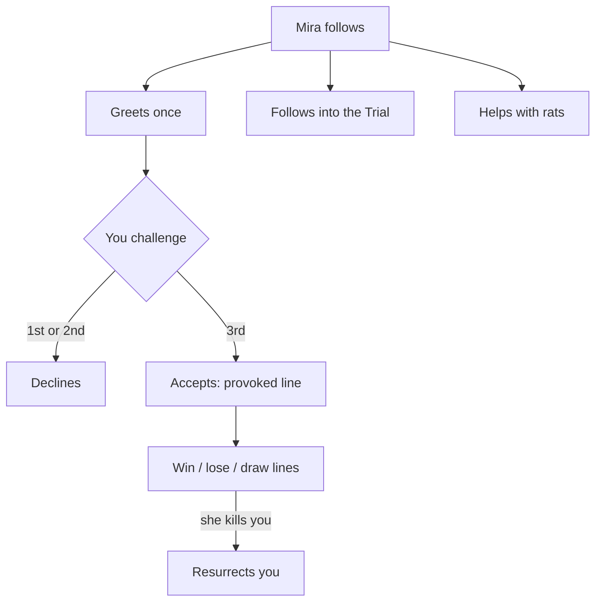

# Mira, the AI fellow apprentice

Collection CV-MIRA. A second wizard seat in a single-player game; she is not a villager and has no conversation card (talk and inspect are refused). Her voice is short messages.

## The story at a glance

```text
Mira follows you (2 to 6 tiles) and greets you once when close ............. ‘I learned my colours here a season ago…’
│
├── You challenge her (pvp_challenge)
│     ├── 1st and 2nd request ... declines with a line (counted as a provocation); a duel never starts
│     └── 3rd request ........... accepts with a ‘provoked’ line (‘Three times…’)
│            ├── she wins ... ‘Your Ward held that time…’ · her regard for you +3
│            ├── she loses .. ‘Well cast. You read my Ward faster…’ · her regard −4
│            └── draw ....... ‘Neither of us broke through.’
├── She kills you in a lethal duel .. ‘Oh no. Stay exactly there, I know the words.’ → walks to your body and resurrects you
├── You kill her ................... she stays dead until brought back; when you do: ‘You brought me back. I remember exactly who put me there.’ (regard +8)
├── Rats ........................... helps once the keeper has complained: ‘One rat fewer…’ / ‘It got away.’
└── The Trial ...................... follows in (‘Wait for me…’), comments on zones, leaves when you do; if grounded by her mother she cannot enter
NEVER SPOKEN: ‘you_died_again’ (2 lines)
```




## Her parameters (ai_wizards.json)

- thinks 2.5 to 6 seconds between casts; guesses with the candidate-filter solver; mistake rate 0
- starts with regard 25; accepts if regard ≥ −10 and she has been asked at least twice; win +3, loss −4, killed −12, resurrected +8
