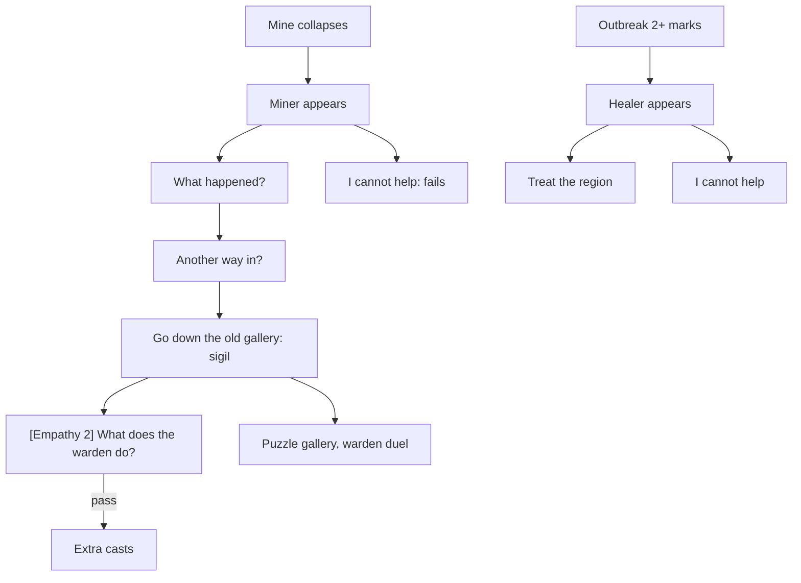

# Legacy story layer: the collapsed gallery and the outbreak healer

Collections CV-LEGACY-MINE and CV-LEGACY-OUTBREAK. These older quests are still wired into the live simulation. They appear only when the simulation produces a trigger; the player cannot start them.

## The story at a glance

```text
MINE COLLAPSES (tremor, war damage or age)                    OUTBREAK (2+ marks in a settlement's region)
│                                                               │
└── A miner stands beside the mine                              └── A healer stands in the settlement
      ├── ‘What happened to the mine?’ → cause (+1 evidence)           ├── ‘I will treat the region…’ → stand in the region and use Treat
      ├── ‘Is there another way in?’ → the old gallery                 └── ‘I cannot help.’ → the outbreak stays
      ├── ‘I will go down the old gallery.’ → a sigil                  Outcomes: treated · passed by itself · settlement destroyed
      ├── [Empathy, easy 2] ‘Tell me what the warden does.’
      │       PASS → miner's regard +15; the warden duel gets extra casts
      │       FAIL → ‘You do not know what I know.’
      └── ‘I cannot help.’ → quest fails, regard −20
   Then: the old gallery (a puzzle dungeon) and the warden's Mastermind duel:
        win → the gallery reopens now ‘full’ · lose → ‘thin’: the crew finishes the dig in a few minutes
```


