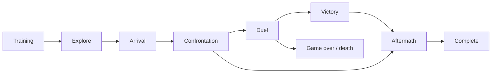

# The whole opening at a glance

How the stages of the campaign follow each other, with the actual timing from config.json.

## The story at a glance

```text
NEW WORLD
 ▼ opening narration (3 paragraphs)
TRAINING  — the mentor's lessons (meet → colours → told Ward → hidden Ward)
 │  ends: four lessons done  OR  a wizard duel / death has happened  OR  5 min of game time
 ▼
EXPLORE   — free play; quests unlock (4 lessons or 20 min); rats; Mira (single player); mother; Trial gate
 │  the stranger comes: 3 min AND 3 contacts, or 7 min regardless, only if no conversation / duel / dungeon is open
 ▼
ARRIVAL → CONFRONTATION (mentor killed) → [challenge] DUEL → VICTORY      or      [let go] ─┐
                                              └── defeat → GAME OVER / death              ▼
AFTERMATH — villagers react; ends after 2 conversations or 150 s ◄───────────────────────┘
 ▼
COMPLETE  — journal: ‘Objective: seek greater magical power.’ (the next chapter is not built)
```


