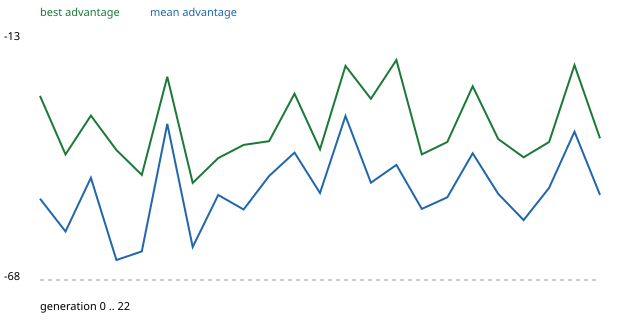

# M6 proof of evolution — report

Run `proving` (proving60): 23 generations, 60-minute games, population 16, 2 seeds per generation, catastrophe level C0 (outbreak scale 1.0).

## Verdict

**FAIL**: final best (generation 22) against generation-0 best on 8 held-out seeds x 2 legs: mean advantage +1.9, 90% lower bound -0.8, seeds won 4/8, collective-loss rate 0.00 vs 0.00.

Acceptance rule: mean advantage above 0 with a bootstrap 90% lower bound above 0, and every paired held-out seed won. A run that merely completes fails.

## Learning curves

| generation | best advantage | mean advantage | best raw fitness | commands per tick | rejected % | sigma | best from |
| ---: | ---: | ---: | ---: | ---: | ---: | ---: | --- |
| 0 | -25.8 | -49.2 | 1028.3 | 2.29 | 1.65 | 0.105 | imitation |
| 1 | -39.2 | -56.7 | 1021.5 | 2.10 | 1.49 | 0.105 | imitation |
| 2 | -30.3 | -44.5 | 1024.8 | 2.12 | 2.54 | 0.106 | imitation |
| 3 | -38.2 | -63.2 | 1026.2 | 2.34 | 1.42 | 0.105 | random |
| 4 | -43.8 | -61.3 | 1026.5 | 2.44 | 0.86 | 0.110 | imitation |
| 5 | -21.5 | -32.2 | 1028.3 | 2.39 | 0.69 | 0.108 | random |
| 6 | -45.7 | -60.3 | 1023.2 | 2.15 | 1.12 | 0.106 | imitation |
| 7 | -40.0 | -48.4 | 1019.5 | 2.28 | 4.43 | 0.108 | imitation |
| 8 | -37.0 | -51.7 | 1023.7 | 2.29 | 4.67 | 0.108 | imitation |
| 9 | -36.2 | -44.1 | 1024.0 | 2.42 | 2.14 | 0.114 | random |
| 10 | -25.3 | -38.8 | 1032.5 | 2.35 | 1.55 | 0.115 | imitation |
| 11 | -38.0 | -48.0 | 1020.3 | 2.53 | 2.28 | 0.115 | random |
| 12 | -19.0 | -30.4 | 1030.3 | 2.42 | 3.22 | 0.116 | random |
| 13 | -26.5 | -45.6 | 1029.8 | 2.25 | 0.46 | 0.113 | random |
| 14 | -17.7 | -41.6 | 1036.3 | 2.18 | 2.31 | 0.114 | imitation |
| 15 | -39.2 | -51.6 | 1026.3 | 2.60 | 3.06 | 0.115 | imitation |
| 16 | -36.3 | -48.9 | 1024.7 | 2.45 | 2.68 | 0.115 | imitation |
| 17 | -23.7 | -38.9 | 1037.5 | 2.57 | 3.28 | 0.115 | random |
| 18 | -35.7 | -48.1 | 1020.0 | 2.61 | 2.82 | 0.116 | imitation |
| 19 | -39.8 | -54.1 | 1022.5 | 2.41 | 2.93 | 0.113 | random |
| 20 | -36.3 | -46.8 | 1021.0 | 2.44 | 2.27 | 0.111 | random |
| 21 | -18.8 | -34.0 | 1033.7 | 2.80 | 1.75 | 0.110 | random |
| 22 | -35.5 | -48.4 | 1027.2 | 2.42 | 1.78 | 0.108 | imitation |

## Imitation-seeded lineage

Parent advantage, imitation lineage: mean -39.3 (first -35.3, last -35.5); random lineage: mean -44.3 (first -52.2, last -54.0). The imitation lineage held the best entry in 13 of 23 generations; adoptions: 0.

## Behaviour grid (2/18 cells)

- cell 0,0,0: raw fitness 1025.3 (imitation, generation 21)
- cell 0,1,0: raw fitness 1037.5 (random, generation 17)

## Decision statistics (last generation)

Heads used: H1 30%, H2 6%, H3 8%, H4 10%, H5 13%, H6 5%, H7 1%, H8 21%, H9 6%; commands per tick 2.42; rejected 1.78%.

## Diagnosis checklist

- 1. commands per tick: mean 2.38 (min 2.10, max 2.80) -> ok (near 0 or constantly near 4 means the selection rule or the temperatures)
- 2. rejection rate: mean 2.24% -> ok (above 20% means candidate generation)
- 3. evaluation noise: standard error of one child's advantage 9.3 against the spread between children 12.0 -> ok
- 4. sigma: first 0.105, last 0.108, min 0.105, max 0.116 -> ok

Champion promotions during the run: 0; current champion: none.

## Additional evidence: each lineage's final mean against the genome it started from (`scripts/compare_genomes.py`)

The acceptance rule compares the *best entry* of generation 0 with the best entry of the last generation, and both are maxima of 16-18 noisy evaluations (and the generation-0 best was an imitation-seeded entry). A cleaner question is whether a lineage improved on its own starting point. Held-out, 6 seeds x 2 legs (12 paired games each), three `plus` opponents, 60-minute games, level C0:

| lineage | final parent mean (generation 22) against its start | mean advantage | 90% lower bound | seeds won | fitness candidate / start |
| --- | --- | ---: | ---: | ---: | --- |
| random initialisation | `theta/gen_000022_ran.npy` against `theta0.npy` | **+15.4** | **+11.7** | **6 / 6** | 1018.5 / 1003.2 |
| imitation-seeded | `theta/gen_000022_imi.npy` against `theta0_imitation.npy` | -1.2 | -3.9 | 2 / 6 | 1020.7 / 1021.9 |

So the evolution loop did produce learning (the random lineage improved significantly from random weights), but not beyond what the imitation seed already gave, and the pre-registered acceptance rule is **not met**.
Neural seats are still well below the heuristic AI: advantage over the all-`plus` control was about -40 (range -19 to -64) over the last ten generations against about -57 over the first five.

## What this run changed, honestly

- Attempt 1 (Adam 0.02, scouting only) and attempt 2 (+expansion on unexplored ground, Adam 0.006) were stopped after 5 generations each (parents drifted down). Attempt 3 added the anchor guard (a paired revert of a worse parent, a deviation from design 7.1) and ran 23 generations in 4 hours (`run/` here; large files stay in `%USERPROFILE%\dmb_runs\neuro\proving`, the earlier attempts in `proving-attempt1` and `proving-attempt2`). The planned 8 hours were not used.
- The checklist of the plan found nothing (commands per tick 2.4, rejections 2.2%, sigma stable) but its third check passes only marginally: the standard error of one child's advantage (9.3) is close to the spread between children (12.0). More games per entry would be the next lever, and a lower-dimensional search (the heads' output layers and temperatures only) the one after.
- No candidate ever had a positive advantage over the heuristic AI, so no champion was promoted and `neuro/models/` stays empty.
